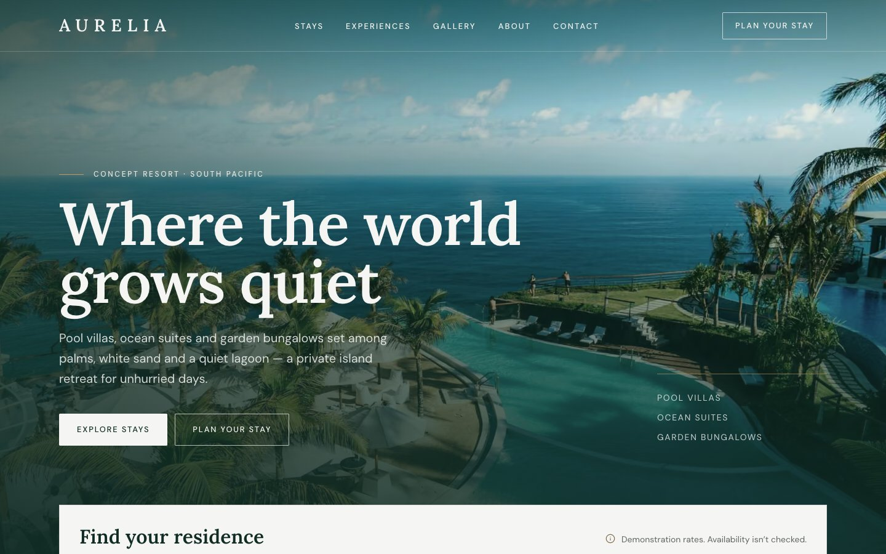
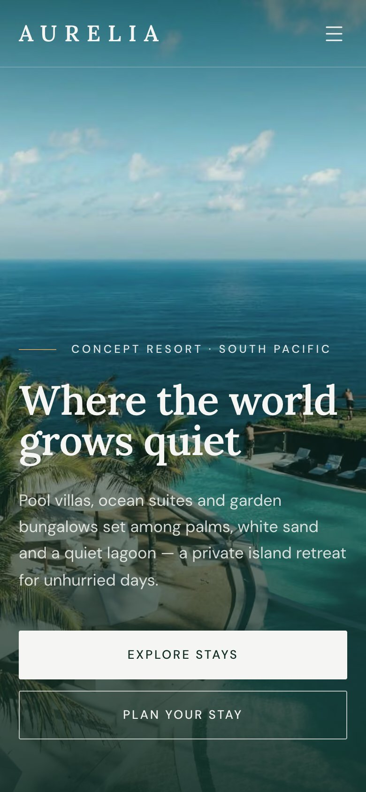
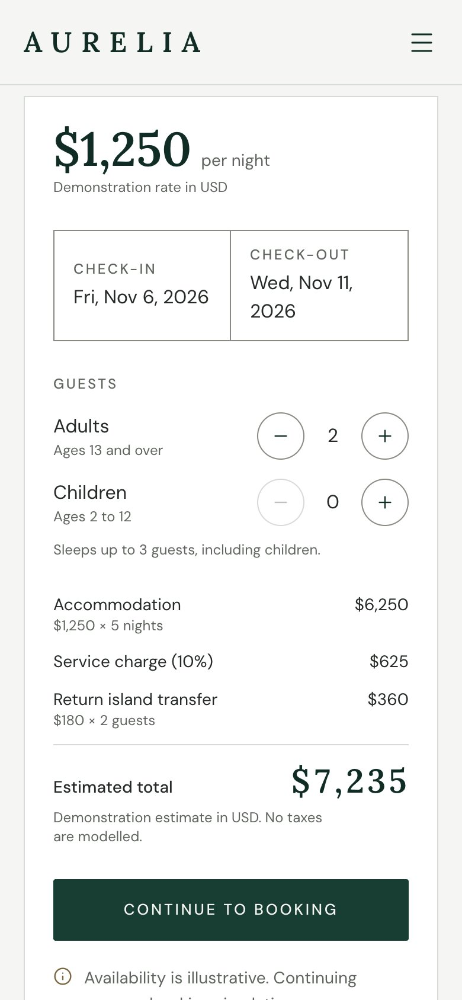
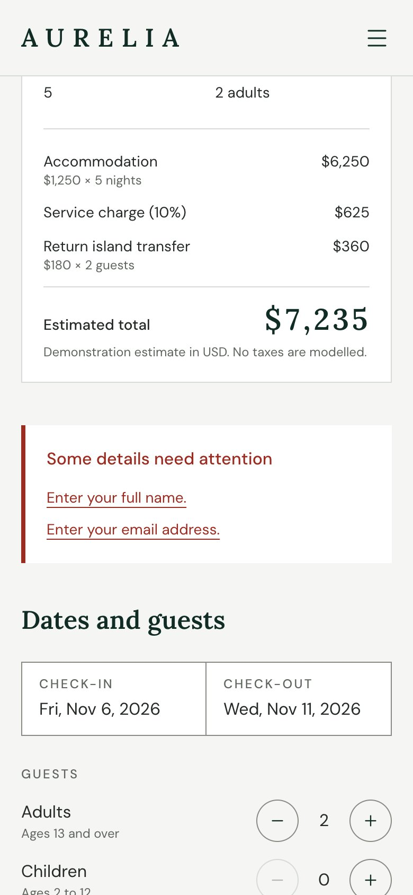

# AURELIA — Luxury Tropical Resort & Retreats

A design-led frontend portfolio project: a fictional island resort in the South Pacific with
accommodation discovery and a fully simulated booking flow. Built with Next.js 16, React 19,
TypeScript and Tailwind CSS 4. See [`PROJECT_SPEC.md`](./PROJECT_SPEC.md) for the brief.

> **Demonstration only.** AURELIA is fictional. Prices, availability and guest notes are
> illustrative. No reservations, payments or enquiries are created, stored or transmitted.



<table>
  <tr>
    <td></td>
    <td></td>
    <td></td>
  </tr>
</table>

More screens are in [`docs/screenshots`](docs/screenshots): the stays listing with carried-over
dates, a residence page, the date picker, the booking form and confirmation, and the gallery
lightbox.

## Features

- **Stays** (`/stays`): filter by residence type, party size and nightly rate, and sort.
  All filter state lives in the URL, so results are shareable and survive reload and Back.
  Dates from the homepage search carry through the listing to every residence.
- **Residence pages** (`/stays/[slug]`): photo gallery, facts and amenities, related stays,
  and a booking panel. The panel has an accessible range calendar, guest steppers that respect
  capacity, and an itemised estimate.
- **Booking simulation** (`/book`): choose a residence, edit dates and guests, enter guest
  details, then get an in-page confirmation with a clearly labelled `AUR-DEMO-…` reference.
- **Experiences, gallery, about, contact**: an editorial experiences list whose calls to action
  prefill an enquiry; a filterable gallery with a keyboard and swipe lightbox; concept copy for
  the story and sustainable design; and a validated demo enquiry form.
- **Production details**: canonical URLs, Open Graph and Twitter cards (a generated default card,
  and each residence's own photo), sitemap, robots rules that keep preview deployments out of
  search results, web manifest, icons and baseline security headers.

## Stack

- Next.js 16 (App Router, Turbopack, typed routes) · React 19 · TypeScript 5.9 (strict, with
  `noUncheckedIndexedAccess`)
- Tailwind CSS 4 with CSS-first design tokens (`src/app/globals.css`)
- `next/font` (Lora, DM Sans), lucide-react, react-day-picker 10
- Vitest (unit) · Playwright + axe-core (end-to-end and accessibility) · Prettier · ESLint

Runtime dependencies are deliberately minimal: `next`, `react`, `react-dom`, `lucide-react` and
`react-day-picker`. There is no state library, UI kit or animation library.

## Getting started

Requires Node.js 20.9 or later.

```bash
npm install
npm run dev          # http://localhost:3000
```

| Command             | Purpose                                                   |
| ------------------- | --------------------------------------------------------- |
| `npm run dev`       | Development server                                        |
| `npm run build`     | Production build                                          |
| `npm run start`     | Serve the production build                                |
| `npm run typecheck` | Generate route types and run `tsc --noEmit`               |
| `npm run lint`      | ESLint (`eslint-config-next`)                             |
| `npm run format`    | Prettier (with Tailwind class sorting)                    |
| `npm run test`      | Vitest unit tests                                         |
| `npm run test:e2e`  | Playwright suite (builds and serves the app first)        |
| `npm run check`     | Typecheck, lint, format check and unit tests              |
| `npm run images`    | Re-download and grade photography from the image manifest |

Run `npx playwright install chromium` once before the first end-to-end run. To use an existing
Chromium build instead, set `PLAYWRIGHT_CHROMIUM_EXECUTABLE=/path/to/chrome`.

### Deployment

The project deploys to Vercel with no configuration: import the repository and deploy. The
canonical base URL comes from `NEXT_PUBLIC_SITE_URL` if set, otherwise from Vercel's production
domain (`VERCEL_PROJECT_PRODUCTION_URL`), otherwise `http://localhost:3000`. Preview deployments
serve a `robots.txt` that disallows crawling.

## Architecture

```
src/
  app/          Routes, metadata files (OG image, sitemap, robots, manifest, icons), tokens
  components/   layout/ · ui/ (primitives, form fields) · booking/ · stays/ · home/ · gallery/ …
  data/         Typed local mock data and site configuration
  lib/          Pure domain logic with colocated unit tests
  types/        Domain types, shaped so they could map to database tables later
  assets/       Bundled photography and the fonts used by the social card
tests/e2e/      Playwright specs (routes, flows, accessibility, SEO, runtime health)
scripts/        Image pipeline and its manifest
```

**Server first.** Pages are Server Components. Client components are limited to what needs
state or browser APIs: the header's scroll state, the mobile menu, filters, the date picker,
forms and the lightbox. Data stays on the server. For example, the residence image in the
booking summary is rendered on the server and passed into the client flow as a slot.

**The URL as state, but never for personal data.** Filters, dates and guest counts are parsed
tolerantly (malformed values are dropped, never thrown) and serialised in a stable order. The
booking flow mirrors its selection with `history.replaceState`. Names, emails and messages
exist only in component state.

**Static where possible.** Residence pages are pre-rendered with `generateStaticParams`, and
their booking panels read the query string on the client inside a Suspense boundary, so the
pages stay static. `/contact` uses the same pattern for its prefilled message. Only `/stays`
and `/book` render on demand, because they read search params on the server.

### Domain logic (`src/lib`)

- `dates`: calendar dates as `YYYY-MM-DD` strings with UTC arithmetic, so night counts and
  display never shift with time zones or daylight saving. "Today" is read from the visitor's
  clock on the client only. Unit tests run in UTC+14 to catch accidental local-time maths.
- `pricing` / `money`: estimates in integer minor units (cents) with explicitly configured fees
  (`src/data/pricing.ts`: a 10% service charge and a per-guest island transfer). Percentage
  fees are rounded once, and totals are always recomputed, never read from the URL.
- `booking`: check-in window (18 months), stay length (1–30 nights) and capacity rules, where
  children count towards capacity.
- `stay-query` / `booking-params`: URL parsing and serialisation.
- `validation`: guest-details and enquiry rules, with trimming and helpful messages.
- `demo-reference`: unbiased random `AUR-DEMO-XXXXXX` codes from an alphabet without
  look-alike characters, generated on submit rather than during render.

## Accessibility

- Semantic landmarks, one `h1` per page, a skip link and visible focus rings. Text and control
  contrast is checked against the tokens, which is why `muted` is darker than the brief's
  starting value.
- Dialogs (mobile menu, date picker, lightbox) use the native `<dialog>` for focus containment,
  Escape to close and focus return. The page doesn't scroll behind them.
- Forms use `noValidate` with labelled controls, `aria-invalid`, `aria-describedby` and an
  error summary that takes focus and links to each field. Steppers use `aria-disabled` at their
  limits, so focus isn't lost.
- Motion is limited to CSS scroll-driven reveals and transitions, all disabled under
  `prefers-reduced-motion`.
- Pages, dialogs and form states are scanned with axe (WCAG 2.2 A/AA) in the end-to-end suite.

## Privacy and security

- No secrets, no external APIs and no remote images at runtime. Photography and fonts are
  bundled.
- Personal data is never written to the URL, cookies or storage, and the tests assert this.
  Form submit buttons stay disabled until hydration, so a native submit can never put details
  into a query string.
- No payment fields anywhere. Every booking and enquiry surface carries a demo notice.
- Contact details are clearly fictional: an `.example` domain and a 555-01xx phone number.
- Response headers set `X-Content-Type-Options`, `X-Frame-Options`, `Referrer-Policy`,
  `Permissions-Policy` and a CSP covering `frame-ancestors`, `base-uri`, `form-action` and
  `object-src`. A full script CSP is left out on purpose: Next.js inlines bootstrap scripts,
  so a meaningful policy needs per-request nonces, which would make every page dynamic.

## Testing

`npm run check` runs typecheck, lint, format check and 104 unit tests. `npm run test:e2e` runs
the Playwright suite in a desktop (1440×900) and a mobile (Pixel 7) project. It covers:

- every route, navigation and the 404 page;
- filters, sorting and URL persistence;
- the booking panel, flow and confirmation;
- contact validation and acknowledgement;
- the gallery lightbox;
- behaviour without JavaScript;
- no horizontal overflow at common widths;
- metadata, sitemap, robots and headers;
- zero console errors or failed requests on every page;
- axe scans of pages and interactive states.

## Performance

Measured with Lighthouse 12.8.2 against `next start` in headless Chromium on a cloud container,
using the default mobile preset (simulated slow 4G, 4× CPU slowdown) unless noted. Scores vary
between machines and runs; re-measure on the deployed site.

| Page                                  | Performance | Accessibility | Best practices | SEO |
| ------------------------------------- | ----------- | ------------- | -------------- | --- |
| `/` mobile (median of 3; range 84–92) | 88          | 100           | 100            | 100 |
| `/` desktop preset                    | 100         | 100           | 100            | 100 |
| `/stays`                              | 97          | 100           | 100            | 100 |
| `/stays/lagoon-pool-villa`            | 95          | 100           | 100            | 100 |
| `/book?stay=lagoon-pool-villa`        | 98          | 100           | 100            | 100 |
| `/gallery`                            | 91          | 100           | 100            | 100 |
| `/contact`                            | 99          | 100           | 100            | 100 |

Cumulative layout shift is 0 on every page measured. Two findings from profiling are now built
in:

- `next/image` draws blur placeholders as an SVG Gaussian blur, which cost about 700 ms of
  main-thread time behind the full-screen hero. Above-the-fold images now skip it, and lazy
  images keep it.
- The date-picker library is loaded on demand when a date field is hovered or focused, so it
  is no longer in the homepage bundle.

The hero is also served at quality 60, where its scrims hide compression.

## Photography and fonts

All photographs are free-licence images from [Unsplash](https://unsplash.com/license), bundled
locally in `src/assets/images`. `scripts/images.manifest.json` records the source of every file.
`npm run images` re-downloads any missing file and applies one shared colour grade so photos from
different photographers sit together. Pass `-- --force` to regenerate everything; behind an HTTP
proxy, set `NODE_USE_ENV_PROXY=1`.

Every image has been checked at full size for logos, watermarks and recognisable brand marks,
because a fictional resort must not borrow a real one's identity. Repeat that check when adding
photos.

Photographers confirmed through the Unsplash API so far (matched by image ID, also recorded in the manifest):

| Image                            | Photographer                                            | Source                                                                                                                      |
| -------------------------------- | ------------------------------------------------------- | --------------------------------------------------------------------------------------------------------------------------- |
| `coast/shore-sunset`             | [Cristofer Maximilian](https://unsplash.com/@cristofer) | [View on Unsplash](https://unsplash.com/photos/beach-seashore-during-sunset-uQDRDqpYJHI)                                    |
| `experiences/floating-breakfast` | [Rayyu Maldives](https://unsplash.com/@rayyu)           | [View on Unsplash](https://unsplash.com/photos/floating-breakfast-trays-in-turquoise-pool-yWFF1xkULew)                      |
| `experiences/spa-flower-bath`    | [Raajit Sharma](https://unsplash.com/@raajit)           | [View on Unsplash](https://unsplash.com/photos/a-bath-room-with-a-bath-tub-and-a-tray-of-flowers-7Q1Jwr5BhgI)               |
| `experiences/spa-treatment-room` | [Doan Anh](https://unsplash.com/@b07sgn)                | [View on Unsplash](https://unsplash.com/photos/a-basket-of-food-on-a-table-guinijRsKbs)                                     |
| `resort/cabanas-dusk`            | [Saad Khan](https://unsplash.com/@sakhan88)             | [View on Unsplash](https://unsplash.com/photos/resort-viewing-blue-sea-under-blue-and-white-sky-during-daytime-425b2PhNuHA) |
| `resort/lagoon-aerial`           | [Thomas Stadler](https://unsplash.com/@thomasstadler)   | [View on Unsplash](https://unsplash.com/photos/aerial-view-of-white-and-gray-boat-on-sea-during-daytime-LFRUK7mslpk)        |
| `stays/beach-bungalow-pool`      | [Ron Fijian](https://unsplash.com/@ronfajilan123)       | [View on Unsplash](https://unsplash.com/photos/luxury-resort-with-pool-and-thatched-roof-bungalows-S-CIlXHTJY0)             |
| `stays/garden-bungalow-thatch`   | [Kelsey Curtis](https://unsplash.com/@kelseycurtis)     | [View on Unsplash](https://unsplash.com/photos/thatch-huts-and-houses-by-the-pool-during-day--27u_GzlAFw)                   |
| `stays/lagoon-villa-pool`        | [Amar Hussain](https://unsplash.com/@gapyearescape)     | [View on Unsplash](https://unsplash.com/photos/a-large-swimming-pool-surrounded-by-palm-trees-ZKvi9r4yzQw)                  |
| `stays/reef-suite-pool`          | [Rosemary Media](https://unsplash.com/@rosemarymedia)   | [View on Unsplash](https://unsplash.com/photos/infinity-pool-overlooking-tropical-beach-TKtTW6z0uAA)                        |
| `stays/residence-pavilion`       | [Roberto Nickson](https://unsplash.com/@rpnickson)      | [View on Unsplash](https://unsplash.com/photos/chairs-near-pool-EeeKjwm2vDo)                                                |

The remaining photographers can be matched the same way; the API's demo rate limit (50 requests
an hour) stopped this pass early.

Headings and prices use Lora (SemiBold) and body text uses DM Sans, both under the SIL Open
Font License (`src/assets/fonts/OFL-Lora.txt`, `src/assets/fonts/OFL-DMSans.txt`). Pages load
both through `next/font`, and the social card uses static TTF instances.

## Scope and future work

This release is frontend only: local typed mock data, simulated booking and client-side
validation. A production version would need:

- server-side validation;
- real availability with transactional reservations;
- payments through a compliant provider;
- authentication and secure sessions;
- database authorisation policies;
- rate limiting;
- a privacy policy and consent handling.

The domain types in `src/types` were shaped with that mapping in mind.
